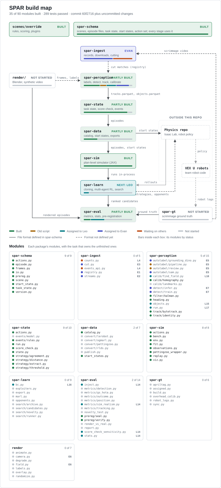

# SPAR: Synthetic Play from Archived Replays

SPAR turns livestream video of VEX robot matches into multi-robot training data, checks that data
against the official match scores, and combines it with simulation to train robot policies and to
search for strategies nobody has played yet. The test case is VEX Override (2026 to 2027 season).

- Full technical design: [docs/SPAR_Repo_Spec_V1.md](docs/SPAR_Repo_Spec_V1.md)
- Research proposal: [docs/SPAR.pdf](docs/SPAR.pdf)

**Status:** early build, with no real match data through it yet. Built and tested on synthetic
data: the shared contract, the Override scene and its scoring, field calibration, tracking and
heading, the task state, score check, events, actions and strategy codes, the episode catalog and
start states, the plan-level simulator, and pre-registration. Still to come: ingest, detection,
object tracks, learning, most metrics, scrimmage ground truth and rendering.
[Where things stand](#where-things-stand) lists both, and the [build map](#build-map) shows it
module by module.

## Quick start

You need [git](https://git-scm.com/) and [uv](https://docs.astral.sh/uv/). uv downloads the right
Python (3.12) by itself.

```bash
# Install uv (once)
curl -LsSf https://astral.sh/uv/install.sh | sh                          # Linux or macOS
powershell -ExecutionPolicy ByPass -c "irm https://astral.sh/uv/install.ps1 | iex"   # Windows

# Get the code and install everything
git clone https://github.com/UW-VexU/UWAT-SPAR.git
cd UWAT-SPAR
uv sync
uv run pre-commit install    # once per clone: checks every commit

# Check it works
uv run spar --help
uv run pytest
```

`uv sync` creates `.venv/` and installs every workspace package in editable mode, so code changes
take effect without reinstalling. Run it again after pulling or after changing any
`pyproject.toml`.

`uv run pre-commit install` adds a git hook that runs ruff and a few file checks on every commit,
including a block on files over 1 MB so video and model weights can't slip into git. Git doesn't
share hooks through the repo, so everyone runs it once in their own clone, including anyone who
cloned before it was added. If a commit is stopped because the hook fixed something, add the
fixed files and commit again.

## Everyday commands

| Command | What it does |
|---|---|
| `uv sync` | Install or update `.venv` to match `uv.lock` |
| `uv run spar --help` | List the command groups. `uv run spar ingest --help` lists one group's commands |
| `uv run pytest` | Run every test (`tests/`, each `packages/*/tests/` and each `scenes/*/tests/`) |
| `uv run pytest packages/spar-schema` | Run one package's tests |
| `uv run pytest tests/test_workspace.py -k cli` | Run one file, filtered by test name |
| `uv run ruff check` | Lint. Add `--fix` to apply safe fixes |
| `uv run ruff format` | Format the code |
| `uv add --package spar-ingest yt-dlp` | Add a dependency to one package (updates its `pyproject.toml` and `uv.lock`) |

CI ([.github/workflows/ci.yml](.github/workflows/ci.yml)) runs the same three checks on every
push to `main` and every pull request, so run them before you push:

```bash
uv run ruff check && uv run ruff format --check && uv run pytest
```

## Testing

| Where | What goes there |
|---|---|
| `packages/spar-<name>/tests/` | Unit tests for that package. Use tiny synthetic tables built in the test, not real data |
| `scenes/<game>/tests/` | Tests for that game's scoring rules, with hand-built states. Only these may mention a game |
| `tests/` | Cross-package and end-to-end tests |
| `tests/fixtures/` | Small files checked into git. `tests/fixtures/frames/` holds 8 livestream screenshots |

- Tests must run on a CPU, without `$SPAR_DATA` and without network access, because CI runs on
  CPU-only GitHub runners.
- Larger test data, such as the 30 s sample match with hand labels, is fetched by
  `scripts/fetch_test_data.py` (not written yet) and never committed.
- pytest uses `--import-mode=importlib`, so test files in different packages may share a name.
- Covered so far: `tests/test_workspace.py` checks that every package imports and that `spar`
  mounts every command group, and `tests/test_scenes.py` loads every scene. Package tests cover
  `spar-schema` (scene loader, action set, task state, start states, episode format),
  `spar-perception` (calibration, smoothing, tracking, identity and heading on synthetic
  cameras), `spar-state` (task state, score check, events, actions, strategy codes), `spar-data`
  (catalog, start states), `spar-sim` (the environment under `jit` and `vmap`, timing fits, the
  replay check, the PettingZoo wrapper, the benchmark) and `spar-eval` (sealing and verifying a
  pre-registration). `scenes/override/tests/` covers every scoring rule in NumPy and JAX, and the
  Override plugins on synthetic matches, including a replay that reproduces a match's score. A
  package with no tests prints `no tests ran`.
- Package tests that need a scene use a small made-up one, like
  `packages/spar-schema/tests/fixtures/toy_scene/`, so they don't depend on a real game.

## How the repo is organized

```text
UWAT-SPAR/
├── pyproject.toml     workspace root: member list, dev tools, ruff and pytest settings
├── uv.lock            exact versions of every dependency, committed
├── .github/workflows/ CI: lint and tests on every push and pull request
├── scenes/            game rules, one folder per game (override, pushback, pinnacle)
├── packages/          the Python packages, one per pipeline stage (table below)
├── render/            Blender rendering, its own environment (not in the uv workspace)
├── configs/           configs: ingest/, perception/, learn/, search/, eval/ (Hydra)
├── docker/            main.Dockerfile and render.Dockerfile (placeholders for now)
├── scripts/           one-off utilities, such as fetching test data
├── tests/             cross-package tests and small fixtures
└── docs/              spec, proposal, scene authoring guide, data format guide
```

### The packages

The pipeline runs top to bottom. Each stage reads the previous stage's files and writes its own.

| Package | Command | Job | Spec |
|---|---|---|---|
| `spar-schema` | none | Shared contract: scene loading, episode tables, reader and writer. Used by every package and by the physics repo | 5, 6.1 |
| `spar-ingest` | `spar ingest` | Match records from the VEX Events API, stream download, cutting streams into matches | 6.2 |
| `spar-perception` | `spar perception` | Auto-labeling, detector training, tracking, field calibration | 6.3 |
| `spar-state` | `spar state` | Task state, score check against the official score, events, strategy codes | 6.4 |
| `spar-data` | `spar data` | Episode catalog, start states, export to LeRobot, PettingZoo and others | 6.5 |
| `spar-gt` | `spar gt` | Ground truth from our own scrimmages (AprilTags, robot logs) | 6.6 |
| `spar-sim` | `spar sim` | Fast plan-level simulator in JAX | 6.7 |
| `spar-learn` | `spar learn` | Behavior cloning, multi-agent RL, multi-run strategy search | 6.8 |
| `spar-eval` | `spar eval` | Metrics, statistics, sealing the candidate list | 6.9 |
| `spar-cli` | `spar` | Mounts every package's commands under one `spar` command | 4 |

### Inside a package

Every package has the same layout. The folder name uses dashes and the import name uses
underscores: `packages/spar-ingest` is imported as `spar_ingest`.

```text
packages/spar-<name>/
├── pyproject.toml          name, dependencies, workspace sources
├── src/spar_<name>/
│   ├── __init__.py         public API only
│   ├── cli.py              Typer app, mounted as `spar <name>`
│   └── <module>.py         one module per job; each stub's docstring says what it is for
└── tests/
```

### Rules that keep it general

1. **Nothing outside `scenes/` may mention Override or any other game.** Classes, prompts, field
   geometry, scoring rules and strategy code fields are data or plugins loaded from a scene
   folder. Adding a game means adding a scene folder, not editing package code.
2. **Stages talk only through files in the formats from `spar-schema`.** Packages depend on
   `spar-schema` and never import each other's internals. The one exception is `spar-learn`,
   which runs `spar-sim` in-process. This keeps every stage testable on its own.
3. **`spar-schema` stays light.** It depends only on Pydantic, PyArrow and PyYAML, and supports
   Python 3.11 and up, so the physics repo and the render environment can install it.
4. **AGPL and GPL code stays out of the core path.** Ultralytics and BoxMOT go in an optional
   `baselines` extra. `bpy` is used only in `render/`.
5. **Training data cutoff.** Footage recorded after November 30, 2026 may be downloaded but must
   not be processed by any `spar` command until `spar eval seal` has run. Code that cuts, labels
   or otherwise processes footage first calls
   `require_processable(recorded_on, CutoffPolicy.load("configs/eval/prereg.yaml"))` from
   `spar_schema`, which raises `CutoffError` for later footage until a sealed manifest exists.
   `uv run spar eval cutoff` shows the current status.

### Scenes

Each game is a folder in `scenes/`. `scenes/override/` is the reference:

| File | Contents |
|---|---|
| `scene.yaml` | Field, objects, programs, timing, teacher prompts, objective, task state arrays, the simulator's action set |
| `scoring.py` | `score(state, xp)`: points per alliance, written with array operations so it runs in NumPy and JAX |
| `state.py`, `events.py`, `strategy.py`, `sim.py` | Plugins named in `scene.yaml` `plugins:`: the game's part of the task state, events, strategy codes, actions and simulator rules |
| `strategy_code.yaml` | Strategy code fields, distances, weights, coder threshold |
| `landmarks.yaml` | Named field points for calibration |
| `robot_limits.yaml` | Our robots' speed and carry limits, used only by the search |
| `README.md` | Plain-language rules summary with manual links |

Values marked `TODO` still have to be filled in from the game manual.

### render/

`render/` imports Blender as the `bpy` module, and each bpy release pins one Python version, so it
has its own `pyproject.toml` and environment and runs from `docker/render.Dockerfile`. It shares
only files with the main environment. See [render/README.md](render/README.md).

## Data

All data lives under one folder outside git, set by the `SPAR_DATA` environment variable:

```bash
export SPAR_DATA=~/spar-data            # Linux or macOS
$env:SPAR_DATA = "D:\spar-data"         # Windows PowerShell
```

```text
$SPAR_DATA/
├── registry/     events, matches and streams tables
├── raw/streams/  downloaded livestreams
├── frames/       sampled frames for labeling
├── labels/       teacher/, hand/, render/ (COCO segmentation)
├── models/       detector/, landmarks/, event_model/
├── episodes/     <scene>/<rules_version>/<program>/<event_sku>/<episode_id>/
├── start_states/ sampled moments for the simulators (spar data start-states)
├── sim/          fitted simulator timing (spar sim fit)
├── renders/      rendered matches
├── gt/           scrimmage ground truth
├── runs/         Hydra outputs, search archives, checkpoints
└── prereg/       sealed manifests and hashes
```

Never commit video, datasets or model weights. `.gitignore` already blocks `*.mp4`, `*.pt`,
`*.onnx` and `*.safetensors`. Keep API tokens in a `.env` file, which is also ignored. The
episode format is described in section 5.5 of the spec.

## Adding code

**A command.** Add a function to the package's `cli.py`:

```python
@app.command()
def events(season: str):
    """Pull the event list for a season."""
    # Import heavy modules inside the function so `spar --help` stays fast.
    from spar_ingest.events_api import fetch_events

    fetch_events(season)
```

It then runs as `uv run spar ingest events --season override`.

**A dependency.** Add it to the package that uses it, not the workspace root:

```bash
uv add --package spar-perception transformers
uv add --package spar-perception --optional baselines ultralytics   # AGPL, optional extra only
```

Section 10 of the spec lists the planned libraries and versions. Each package's `pyproject.toml`
also has a `# Planned` comment listing its own.

**A game.** Copy the file set from `scenes/override/` into `scenes/<game>/` and fill it in. See
[docs/scene_authoring.md](docs/scene_authoring.md).

## Command line

The commands planned in the spec. Working now: `spar eval seal`, `verify` and `cutoff`;
`spar data catalog` and `start-states`; `spar sim fit`, `replay` and `bench`; and `spar state run`
on one episode folder, which writes the score check, `state.parquet`, `events.parquet`,
`actions.parquet` and `strategy.json` (the spec's `--event` form needs the catalog). The rest are
not written yet:

```bash
spar ingest      events, matches, streams, download, cut, count
spar perception  autolabel, review, train-detector, run
spar state       run
spar data        catalog, start-states, convert, publish
spar gt          build
spar sim         fit, replay, bench
spar learn       bc, search, exploit, export
spar eval        seal, verify, novelty, report
```

Section 7 of the spec shows a full run from match records to the sealed candidate list.

## Legacy auto-labeler

The original scripts were moved unchanged into `spar-perception`. They will become
`spar perception autolabel` and `spar perception review` (spec section 11).

| File | Was | Does |
|---|---|---|
| `autolabel/pipeline.py` | `main.py` | Finds robots with Grounding DINO (prompt "A Vex Robot.", box threshold 0.23, text threshold 0.35), outlines them with SAM 2, writes one YOLO segmentation label file per image. Set `BOXES_MODE = True` to write boxes instead of masks |
| `autolabel/review.py` | `checker.py` | Draws the labeled outlines on each image, with the background blacked out, so a person can check them |

Until they are ported:

- They read `frames/*.jpg` and write `labels/` and `checked/` **relative to the current folder**,
  so run them from a working folder that contains a `frames/` folder, not from the repo root.
- They need torch, transformers, ultralytics, pillow and opencv-python, which the workspace does
  not install yet. One way to run them is with uv adding those for the one run. This gets the CPU
  build of PyTorch. For the GPU, install a CUDA 12.8+ build instead.

  ```bash
  cd path/to/workdir      # contains frames/*.jpg
  uv run --no-project --with torch --with transformers --with ultralytics --with pillow \
      python path/to/UWAT-SPAR/packages/spar-perception/src/spar_perception/autolabel/pipeline.py
  uv run --no-project --with opencv-python --with numpy \
      python path/to/UWAT-SPAR/packages/spar-perception/src/spar_perception/autolabel/review.py
  ```

- The first run downloads the Grounding DINO weights from Hugging Face and `sam2_b.pt` into the
  current folder.

## Roadmap and tasks

### Where things stand

Built and tested on synthetic data. No real matches have gone through the pipeline yet.

| Area | Built |
|---|---|
| `spar-schema` | Scene loading, episode tables, reader and writer, task state, start states, the plan-level action set, the training data cutoff check |
| Override scene | Field geometry and rules from manual v2.1, scoring, and plugins for task state, events, strategy codes, actions and the simulator |
| `spar-perception` | Field calibration, track smoothing (Kalman filter and RTS smoother), tracking (ByteTrack), identity, heading |
| `spar-state` | Task state and score check, events, plan-level actions, strategy codes (`spar state run`) |
| `spar-data` | Episode catalog and start states (`spar data catalog`, `start-states`) |
| `spar-sim` | The JAX plan-level simulator, timing fits, the replay check, the throughput benchmark, the PettingZoo wrapper, the replay plot (`spar sim fit`, `replay`, `bench`) |
| `spar-eval` | Sealing and verifying the pre-registration (`spar eval seal`, `verify`, `cutoff`) |

Still to do:

| Area | What's left | Waiting on |
|---|---|---|
| `spar-ingest` | Registry, stream download and cutting (E1 to E3); the Events API client and match counts (L4) | Events API access, for L4 |
| `spar-perception` | Object tracks with placed and held status (`objects.py`, L15); the auto-labeler port (E5); the fast detector (E7); the landmark keypoint model (`calib/landmarks.py`) | Hand-labeled frames (E4), for all but L15 |
| `spar-state` | The learned event model (`events/model.py`) | Scrimmage video synced to robot logs |
| `spar-data` | Exports to LeRobot, PettingZoo, RLDS and OG-MARL, and publishing (`convert/`, `publish.py`) | Episodes worth exporting |
| `spar-learn` | Behavior cloning (L16); multi-agent RL, the opponent pool, the strategy search and its archive, exploiters, export | Mined episodes for real styles; L16 starts on synthetic ones |
| `spar-eval` | Statistics, score check sensitivity and the simulator's score error (L14); detection, tracking, position and outcome metrics, the novelty test, the report | Real data for the numbers; L14 can start now |
| `spar-gt` | Scrimmage ground truth: AprilTags, overhead camera calibration, robot logs, sync | Tags, the camera mount and the robot log format |
| `render/` | The Blender field, cameras, animation and labels (E6, stretch) | Team CAD meshes and the renderer decision |
| `spar-sim` | Maybe later: drives that go around Goals and other field elements. Shortest-path distances to every destination, worked out once per field on a grid, would replace straight line × detour ratio, and robots would follow those paths mid-drive. Still table lookups, so JAX speed stays | Only if `spar sim replay --sampled` on real matches shows drive times or Midfield counts are off |

### Build map

The spec's architecture, colored by what exists in the repo. Each box's bar shows its modules by
status, and a dashed arrow marks a hand-off whose file format is not defined yet. Under the
diagram, every module is listed by name with its status, and each unfinished one with the task
that owns it (L14 to L16 for Leo, E1 to E7 for Evan).



Redraw it after finishing a task. The script counts the code in each module and runs the tests,
and its `OWNERS` table says who owns unfinished work:

```bash
uv run python scripts/build_map.py
```

### Milestones

A tentative timeline, from section 12 of the spec. The dates will move. The order won't:
perception has to work on real matches first, because mining, learning and the sealed candidate
list all wait on it.

| Milestone | Date | Done when |
|---|---|---|
| Foundations | Nov 8, 2026 | Workspace builds in CI. Override `scene.yaml` loads. Registry and match counts by program exist. 20 matches cut |
| Perception | Nov 29, 2026 | Student detector and tracker run on a full match. Field tracks written with covariance. First error numbers on scrimmage footage |
| Training data cutoff | Nov 30, 2026 | Later footage is downloaded but not processed until the candidate list is sealed |
| Rendering | Dec 6, 2026 | Rendered matches with the stream look go through the main pipeline. Per-stage render error reported |
| Scrimmage ground truth | Dec 13, 2026 | At least one session of synced side-camera, overhead and robot log data |
| Mining | Dec 20, 2026 | Episodes for all pre-cutoff streamed matches, score check pass rates, strategy codes, coder study on 50 matches |
| Search | Jan 10, 2027 | Plan-level sim fitted, cloned styles, multi-run search, exploiters done. Candidate list sealed |
| Tests | Jan 24, 2027 | Novelty test on post-cutoff events, scrimmage tests, VEX U autonomous tests, Push Back retrospective |
| Submission | Feb 1, 2027 | Paper submitted to Autonomous Robots, Synthetic Data for Robot Learning collection |

### Who owns what

Leo and Evan work in parallel, in different time zones. Each area has one owner who writes and
merges changes there. To change an area you don't own, open an issue or comment on the owner's PR.

| Area | Owner |
|---|---|
| `packages/spar-schema/`, `scenes/`, root `pyproject.toml`, CI | Leo |
| `spar-ingest`: `events_api.py`, `counts.py` | Leo |
| `spar-ingest`: `registry.py`, `streams.py`, `cut.py` | Evan |
| `spar-perception/src/spar_perception/autolabel/`, `detect/` | Evan |
| `spar-perception/src/spar_perception/calib/`, `filter/`, `track/`, `heading.py` | Leo |
| `configs/ingest/`, `configs/perception/` | Evan |
| `docs/labeling_guide.md` | Evan |
| `spar_ingest/cli.py`, `uv.lock`, this README | Shared (see the rules below) |

### Leo's tasks

Assigned to Leo. Start with the API access request, since it has the longest wait.

Setup and coordination:

- [ ] Request VEX Events API access, and check whether Evan needs his own token (see the API
      token rule under [Working in parallel](#working-in-parallel-across-time-zones))
- [ ] Agree the field frame x direction with the physics repo owners
- [ ] Give Evan repo access, and set up the private Hugging Face dataset repo for shared data
      (sampled frames, hand labels)
- [ ] Order AprilTag 36h11 tags and plan the overhead camera mount
- [ ] Ask the team for the robot log format, the location of the Push Back MARL pipeline, the
      experiment tracker (Weights & Biases or MLflow) and the CAD exported as meshes
- [ ] Confirm the renderer (Blender) and the license plan with the university

Code:

- [x] **L1.** Commit the skeleton. Add GitHub Actions CI (ruff and pytest on CPU) and pre-commit
- [x] **L2.** `spar-schema` v0.1: `load_scene()`, `SceneSpec`, episode table schemas,
      `EpisodeWriter` and `EpisodeReader`, version checks. Done when the Override scene loads, an
      episode round trip passes in CI and an unknown major version is rejected
- [x] **L3.** Fill the Override `scene.yaml` TODOs from manual v2.1, including landmark names.
      Write `scoring.py` with a unit test for every rule
- [ ] **L4.** Once API access arrives: the Events API client, `spar ingest events`, `matches` and
      `count`, and the count of streamed matches by program
- [ ] **L5.** Review Evan's registry columns (E1) within a day, because E2 and E3 build on them
- [x] **L6.** Field calibration and track smoothing in `spar-perception`: fit the pixel-to-field
      homography from labeled landmarks with OpenCV RANSAC and smooth it over time
      (`calib/homography.py`), and a Kalman filter with an RTS smoother for position, heading,
      velocity and covariance (`filter/kalman.py`). Done when both pass tests on synthetic camera
      views and tracks, and write valid `tracks.parquet` rows
- [x] **L7.** The training data cutoff guard: `spar-eval` `prereg/seal.py` and `verify.py`, and
      a check that stops footage recorded after November 30, 2026 from being processed until
      the candidate list is sealed
- [x] **L8.** Task state and the score check in `spar-state`: build the scene's task state from
      the object and robot tracks at each checkpoint (generic code, plus an Override plugin in
      `scenes/override/state.py`), score it, compare it with the official result, and write
      `state.parquet` and the score check in `episode.json`. Done when a synthetic Override
      episode passes and a wrong one fails, with tests
- [x] **L9.** Tracking and identity in `spar-perception`: link per-frame robot detections into
      tracks with ByteTrack (`track/bytetrack.py`), split a track where its alliance color flips,
      and assign each track to a robot on the match roster by alliance, motion and, in VEX U,
      robot size (`track/identity.py`). Done when synthetic detections of four robots, with
      occlusions and broken tracks, come out as one series per roster robot
- [x] **L10.** Heading in `spar-perception` (`heading.py`): the long axis of each robot's mask,
      mapped onto the field, with the robot's motion picking which way it faces. Done when
      synthetic robots get headings within a few degrees and `tracks.parquet` rows are written
      with heading
- [x] **L11.** Behavior in `spar-state` (spec stage 4), in three parts:
  - [x] **L11a. Events.** Generic rules turn object status changes (picked up, placed,
        removed) and robots entering or leaving field regions into events, and an Override
        plugin adds Toggle flips (`events/rules.py`, `scenes/override/events.py`)
  - [x] **L11b. Strategy codes.** Check, compare and agree on codes: the field types, the
        distance between two codes, the coder threshold and Cohen's kappa (`strategy/`), plus
        an Override plugin that extracts each alliance's five-field code
        (`scenes/override/strategy.py`)
  - [x] **L11c. Wiring.** `spar state run` also writes `events.parquet` and `strategy.json`

  Plan-level actions (`actions.py`) came with the simulator's action set, in L13a.
- [x] **L12.** Episode catalog and start states in `spar-data`: `catalog.py` finds episodes and
      filters them by scene, rules version, program, match date and score check; `start_states.py`
      samples moments from them into `start_states.parquet`, the hand-off to the simulators and
      the physics repo; `spar data catalog` and `spar data start-states`. Done when synthetic
      episodes are found and filtered, and sampled start states match the episodes and round-trip
- [x] **L13.** The plan-level simulator in `spar-sim` (spec section 6.7), in four parts:
  - [x] **L13a. Action set and actions.** The scene declares its plan-level actions in a `sim`
        section of `scene.yaml` (`spar_schema.action_set()`). `spar-state` `actions.py` turns
        events into those actions, and `spar state run` writes `actions.parquet`, with an
        Override plugin in `scenes/override/sim.py`
  - [x] **L13b. Timing.** `fit.py` fits each action's handling time and failure rates, and robot
        speeds, from `actions.parquet`, events and tracks (`spar sim fit`)
  - [x] **L13c. The JAX environment.** `PlanEnv` with pure `reset_from(start, key)` and
        `step(state, actions, key)`, the Override plugin for what each action does, and scoring
        through `scoring.py`. Runs under `jit` and `vmap`
  - [x] **L13d. Replay check, benchmark, wrapper and plot.** Replaying an episode's actions
        from its start reproduces its score (`replay.py`, `spar sim replay`); a throughput
        benchmark (`bench.py`, `spar sim bench`); the PettingZoo wrapper; the replay plot
        (`viz.py`). Done when the synthetic Override match replays to its computed score
        exactly

  First-version simplifications, listed in `spar_sim/env.py` and `scenes/override/sim.py`:
  - Drive time is the straight-line distance times a detour ratio fitted from tracks (how much
    longer real paths are), at the robots' average driving speed. So curves and turns cost
    time, but robots are drawn on the straight line and don't steer around field elements.
    Shortest paths around field elements are listed under [Where things stand](#where-things-stand),
    for later if they turn out to matter
  - Loaders and the floor share one supply of objects
  - Defense works only through the fitted failure rates
- [ ] **L14.** Evaluation in `spar-eval` that can be built and tested before real data
      (spec section 6.9), in three parts:
  - [ ] **L14a. Statistics** (`stats.py`): bootstrap 95% confidence intervals, and Wilson
        intervals for success rates. Done when they match reference values
  - [ ] **L14b. Score check sensitivity** (`inject.py`, `score_check_sensitivity.py`): plant
        known errors in episodes (a swapped robot identity, a missed object, a wrong placement,
        a wrong Toggle) and report the share the score check catches, by error type. Done when
        it runs on synthetic episodes, and an error that can't change the score (swapping two
        partner robots) is reported as never caught
  - [ ] **L14c. Simulator score error** (`metrics/sim_realism.py`): the replay score error over
        many episodes, by match type, with confidence intervals. `spar sim replay` writes its
        results to a file for this, so the two packages stay apart (rule 2). Done when it
        reports the error for synthetic episodes
- [ ] **L15.** Object tracks in `spar-perception` (`objects.py`), which the task state, events
      and actions all read, in three parts:
  - [ ] **L15a. Linking:** per-frame object detections into object tracks over time
        (ByteTrack, as for robots)
  - [ ] **L15b. Status:** held when an object moves with a robot (and which robot), placed when
        it sits on a Goal (which Goal, and its stack level), free otherwise
  - [ ] **L15c. Game attributes:** a scene plugin for what generic code can't name, such as
        Pin half colors and which way a Cup faces (`scenes/override/`)

  Done when synthetic detections of objects being picked up and stacked give an
  `objects.parquet` that passes `spar state run`'s score check
- [ ] **L16.** Behavior cloning in `spar-learn` (`bc.py`): one policy over the simulator's
      plan-level actions, with the strategy code as an input, so it can play any real style
      (spec section 6.8), in three parts:
  - [ ] **L16a. Training data:** observation, action and strategy code for each decision, from
        episodes' `actions.parquet` replayed through `spar-sim` from their start states
  - [ ] **L16b. Policy and training** in JAX, and `spar learn bc`
  - [ ] **L16c. Playback check:** given a style's code, the policy's simulated matches should
        get strategy codes close to that style's (`spar-state` strategy distance)

  Done when a policy trained on synthetic episodes of two scripted styles plays each one back
  in the simulator when given its code

### Evan's tasks

Assigned to Evan. Each task is one branch and one PR. Do E1, E2 and E3 in order. Start E4 as soon as E3 has cut a few matches, and E5
once E4 has frames. The dates are tentative and mainly show the order of work.

#### E1. Stream list and registry tables (tentative: Oct 31)

- **Files:** `spar_ingest/registry.py`, `configs/ingest/`
- **Do:**
  - Pick 3 to 5 streams by hand from at least 2 signature events, including a VEX U event if one
    has been streamed. For each stream record the URL, event code, program (V5RC or VEX U) and
    whether it shows one fixed camera per field. Save it as a small YAML or CSV in
    `configs/ingest/`, with URLs and metadata only. Collecting every stream automatically comes
    later, with `spar ingest streams` and the Events API (L4).
  - Write PyArrow schemas and read and write functions for `registry/streams.parquet` and
    `registry/matches.parquet`. `matches.parquet` must at least map each match to a `stream_id`
    with `start_s` and `end_s` offsets into the stream. Propose the other columns in the PR.
- **Done when:** Leo approves the columns, and a test that writes then reads a tiny synthetic
  table passes.

#### E2. Stream download (tentative: Nov 4)

- **Files:** `spar_ingest/streams.py`, the `streams` and `download` commands in `spar_ingest/cli.py`
- **Do:** a yt-dlp wrapper with resumable downloads into `$SPAR_DATA/raw/streams/<stream_id>.mp4`,
  registering each stream in `streams.parquet`. Read the URLs from the E1 list for now. The Events
  API lookup comes later with L4.
- **Done when:** the streams on the list download, an interrupted download resumes, and the tests
  pass with yt-dlp mocked, since tests must not use the network.

#### E3. Cut streams into matches (tentative: Nov 8)

- **Files:** `spar_ingest/cut.py`, the `cut` command, `configs/ingest/`
- **Do:**
  - Rough cut from approximate match times in the stream, typed by hand for now and taken from
    the Events API later.
  - Find the exact match start from the overlay timer with OpenCV template matching. Keep the
    templates and thresholds in `configs/ingest/`, not in code.
  - Reject segments without a full view of one field, such as stream cuts, replays and other
    fields, and record the reason.
  - Write offsets to `matches.parquet`. Never copy or re-encode video: episodes reference the
    stream by ID and offsets.
  - Before cutting a stream, call `spar_schema.require_processable` with the event's date (see
    rule 5), so footage from after the cutoff is refused until the candidate list is sealed.
- **Done when:** 20 matches from at least 2 events are cut, with start times checked by hand
  against the overlay timer.

#### E4. Labeling guide and 200 hand-labeled frames (tentative: Nov 8)

The biggest task, so start labeling as soon as E3 has a few matches.

- **Files:** `docs/labeling_guide.md`. Labels go to `$SPAR_DATA/labels/hand/` and the shared
  dataset repo, never git.
- **Do:**
  - Set up a labeling tool that exports COCO segmentation, such as CVAT or Label Studio.
  - Write `docs/labeling_guide.md`: what each class covers, and how to handle objects that are
    partly hidden, robots touching each other, and the overlay covering part of the field.
  - Classes: `robot`, `cup`, `pin`, `toggle`, named as in `scenes/override/scene.yaml`. Also mark
    the field landmarks named in `scenes/override/landmarks.yaml` where they are visible.
  - Attributes, because the score depends on them (see `scenes/override/README.md`):
    - each Pin: the color of each half (red, blue or yellow), lower half first as it stands
    - each Cup: whether its gray (opaque) half is up or down
    - each Toggle: which face shows into the field, and whether a Robot is touching it
    - for objects on a Goal: which Goal, and the level in the stack counting up from the Goal

    Pick a tool and export format that keep these attributes, and describe them in the guide.
    `scenes/override/state.py` lists the exact values the score check expects.
  - Sample 200 frames spread across events, cameras and match phases (autonomous, driver,
    endgame), from matches recorded before the November 30 cutoff.
  - Mark a held-out split by match, so the frames used to measure the detector are never
    trained on.
- **Done when:** 200 frames are labeled and exported as COCO, the split is recorded and the
  guide is written.

#### E5. Port the auto-labeler (tentative: November)

- **Files:** `spar_perception/autolabel/`, the `autolabel` and `review` commands in
  `spar_perception/cli.py`, `configs/perception/`
- **Needs:** a CUDA GPU (Evan's own, or the lab desktop remotely), and `load_scene()` from L2.
  Until L2 lands, read the prompts with `yaml.safe_load` behind one function, so switching later
  is a one-line change.
- **Do** (spec section 11):
  - `pipeline.py`: one text prompt per class from `scene.yaml`, per-class thresholds in
    `configs/perception/`, a SAM 3 option next to SAM 2, COCO output, paths under `$SPAR_DATA`.
    Move the model code into `grounding_dino.py` and `sam.py`.
  - `review.py`: read COCO, use a color per class, and add a contact sheet that shows many frames
    on one image.
  - Once both pass lint, ask Leo to drop them from ruff's `extend-exclude` in the root
    `pyproject.toml`.
- **Done when:** `spar perception autolabel` labels the E4 frames and its mAP50 per class
  against the held-out hand labels is reported. That number is the "current chain" baseline in
  the proposal's benchmark table. pycocotools is fine for now; the metric moves to `spar-eval`
  later.

#### E7. Train and run the fast detector (after E4 and E5)

- **Files:** `spar_perception/detect/` (`train.py`, `infer.py`), `configs/perception/`
- **Needs:** E4's hand labels, E5's teacher labels, and a CUDA GPU.
- **Do:**
  - Fine-tune RF-DETR segmentation (the `rfdetr` package) on the teacher labels plus the training
    split of the hand labels. Use the Nano to Large sizes only; the `rfdetr_plus` sizes have a
    different license.
  - Run it over a whole cut match in batches. For each frame, write the robot boxes, scores,
    masks (cropped to each box) and alliance color in the shape L9's tracker reads,
    `spar_perception.track.bytetrack.FrameDetections`.
  - Optional baselines (YOLO26, YOLO-World) go in `detect/baselines/`, under the AGPL
    `baselines` extra only.
- **Done when:** mAP50 per class on the held-out hand labels is reported next to the teacher
  labels' from E5, and one cut match produces detections the tracker accepts.

#### E6 (stretch). Blender field model

Only if Evan knows Blender, after Leo confirms Blender as the renderer and L3 fills the field
positions.

- **Files:** `render/`
- **Do:** build the field (tiles, walls, goals, Toggles, loaders) from `scene.yaml` in
  `render/src/spar_render/field.py`, in the render environment.
- **Done when:** the field builds from `scene.yaml` and renders one frame from a raised side view
  like a livestream camera.

### Values still to fill in

Measurements, decisions and inputs the code is waiting on, and where each one goes. Tick a box
when it is filled in. To list the TODO values left in the Override scene:

```bash
uv run python -c "from spar_schema import load_scene; print(*load_scene('scenes/override').todos, sep='\n')"
```

Decisions:

- [ ] **Field frame x direction**: `scenes/override/scene.yaml` `field.frame.x_axis`. Proposed: x
      toward the blue Alliance Station, y away from the audience, which is the manual's drawing
      frame. Agree with the physics repo (Leo)
- [ ] **Physics repo name**, and the `spar-schema` git tag it will pin (Leo, physics repo owners)
- [ ] **Experiment tracker**: Weights & Biases or MLflow (team)
- [ ] **Renderer**: Blender (recommended) or Isaac Sim Replicator (Leo)
- [ ] **License plan**, confirmed with the university (Leo)

Our robots and team inputs:

- [ ] **Top speed** of the 15 in and 24 in robots: `scenes/override/robot_limits.yaml`
      `max_speed_mps`, measured on the robots
- [ ] **Carry capacity** of each robot, in Pins and Cups: `robot_limits.yaml` `carry`
- [ ] **Robot log format**, and how logs come off the robots: needed by `spar-gt`
- [ ] **Team CAD exported as meshes**: needed by `render/`
- [ ] **Overhead camera mount** location above the practice field: needed by `spar-gt`
- [ ] **Location of the Push Back MARL pipeline**: the baseline and retrospective test

From studies and real data:

- [ ] **Strategy code `missing_penalty` and field weights**: `scenes/override/strategy_code.yaml`,
      from the coder study on 50 matches
- [ ] **Coder threshold**: from the same study, passed to `spar eval seal --threshold`
- [ ] **Kalman noise**: `accel_std` 2.0 m/s² and `angular_accel_std` 8.0 rad/s² in
      `spar_perception.filter.kalman.KalmanConfig` are guesses; tune against scrimmage ground truth
- [ ] **Landmark pixel noise** for `point_covariance`, and the RANSAC threshold (default 3 px):
      measure from the hand labels (E4)
- [ ] **Homography smoothing window** (default 15 frames): tune on real streams
- [ ] **Strategy extraction distances**: how near a Toggle, Loader, Goal or opponent counts for
      `time_split` (0.5 to 0.7 m now) in `scenes/override/strategy.py`; tune against the hand-coded
      matches
- [ ] **Teacher prompts and per-class thresholds**: `scene.yaml` `prompts` and `configs/perception/`,
      tuned on real frames (E5)

Simulator:

- [ ] **Lab GPU throughput**: run `uv run spar sim bench --scene override --program vexu` on the
      lab GPU and record it here (spec section 6.7). A laptop CPU does about 365,000 steps per
      second over 1,024 matches
- [ ] **Fitted timing**: run `spar sim fit --scene override` once mined episodes exist. Until
      then every action has a 1 s median handling time and never fails, robots drive at 1 m/s,
      and the detour ratio is 1 (straight lines)
- [ ] **Our robots' driving speed**: the simulator wants average speed while driving, turns
      included, not top speed. Measure it on a practice run alongside `robot_limits.yaml`
      `max_speed_mps`
- [ ] **Carry and standoff**: `scene.yaml` `sim.carry` (2 items) and `sim.standoff_m` (0.3 m) are
      guesses. Carry should follow `robot_limits.yaml` for our robots and mined tracks for others
- [ ] **Failure and reach distances**: a place counts as failed when its object comes off within
      2 s, and as defended when an opponent is within 0.6 m (`spar_sim/fit.py`); a pick within
      0.6 m of a Loader counts as a load (`scenes/override/sim.py`). Tune on real matches

Field details the manual's drawings don't give:

- [ ] **White tape width**: the Midfield's boundary is the tape's inner edge, but `scene.yaml` uses
      the centerline. Measure a field, or read it from the field's STEP model
- [ ] **Toggle position on the wall**: `scene.yaml` uses the wall's inside face
- [ ] **Load Zone corners**: not in `scene.yaml` yet, so the Quadrant outlines ignore them

### Working in parallel across time zones

- **One branch and one PR per task,** named like `evan/e2-download` or `leo/l2-schema`. The other
  person reviews during their day, so plan on one review round per day and keep PRs small.
- **Rebase on `main` before merging.** `spar_ingest/cli.py` is shared: add each command as its
  own function and keep the diff small.
- **If `uv.lock` conflicts,** take the version on `main`, run `uv lock`, and commit the result.
- **Run the pre-push checks** from [Everyday commands](#everyday-commands) before opening a PR.
- **End each day with a short handoff** in the PR or the team chat: done, blocked, next.
- **Respect the cutoff.** Footage recorded after November 30, 2026 can be downloaded, but not
  cut, labeled or processed until the candidate list is sealed.
- **API token.** Once access comes through, Evan uses the Events API too, and E2 and E3 switch
  from hand-typed match times to the API. Tokens are usually tied to one account, so check the
  API's terms: if they allow it, Evan requests his own token; if not, Leo shares his privately.
  Either way it lives in each person's `.env` file, never in git or a PR.

The full build plan and the open items are in sections 12 and 13 of the spec.
