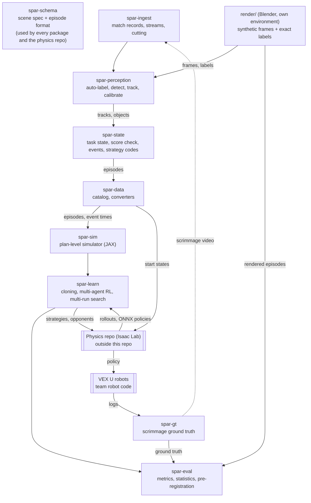
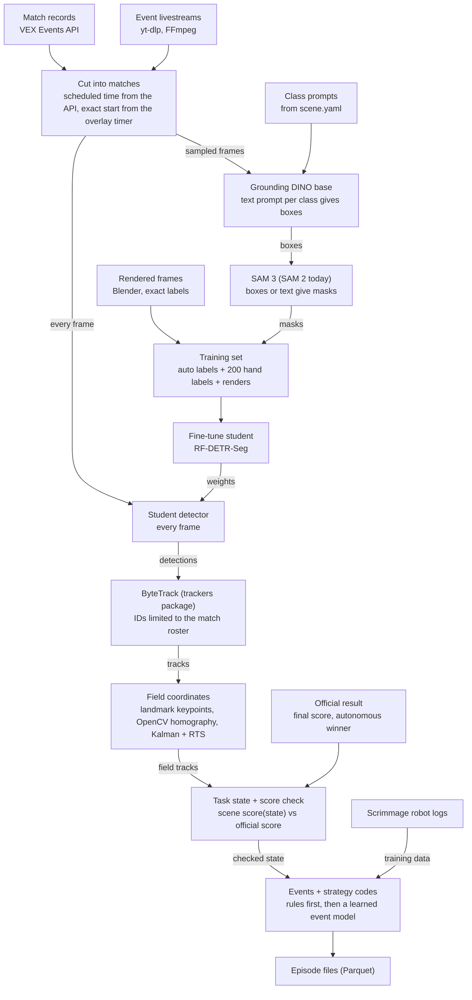
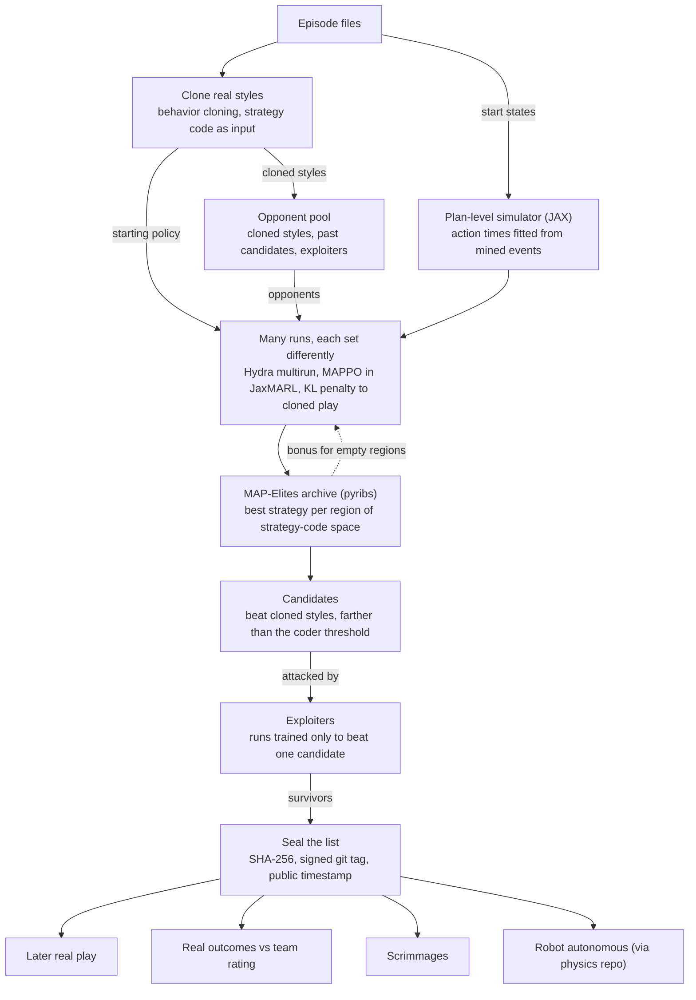
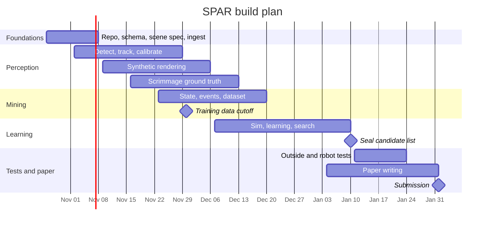

# SPAR repository specification

**SPAR: Synthetic Play from Archived Replays**

Owner: Leo Xie. Spec version 1.0, October 28, 2026.
Based on the SPAR proposal (October 22, 2026) and the SPAR Technical Design doc (https://claude.ai/artifact/2zHDbc6LJkay4qqXin1SfX). Library versions and licenses were checked on October 22, 2026.

Sections 1 to 4 explain what SPAR is and how the repo is laid out. Section 5 defines the shared data contracts. Section 6 specifies every package. Sections 7 to 12 cover running it, the outside interfaces, environments, dependencies, migration and the build plan. Section 13 lists what is still needed from Leo, and section 14 explains the VEX terms.

Function signatures and file names in this spec are proposals. Change them if a better design shows up, but keep the contracts in section 5 stable, because other code depends on them.

---

## 1. What SPAR does

SPAR turns livestream video of VEX robot matches into multi-robot training data. It checks that data against the official match scores, then combines it with simulation to train robot policies and to search for strategies nobody has played yet.

It works in six stages:

1. **Cut and label.** Download event livestreams, cut them into matches, and detect robots and game objects in every frame.
2. **Field coordinates.** Track each robot over time and map it from pixels to positions on the field, with heading and velocity.
3. **Task state and score check.** Rebuild what was scored over time and compare the computed score with the official score.
4. **Behavior.** Extract events (a pin placed, a Toggle flipped) and a short readable "strategy code" for each alliance.
5. **Learn.** Replay real matches in a fast simulator, clone real playing styles, and improve them with multi-agent RL.
6. **Search.** Run many differently configured training runs to find new strategies, then seal the list of candidates and test them against later real matches, scrimmages and our robots.

Synthetic data appears in three places: rendered video to train and test perception, synthetic episodes to scale up learning, and the simulator where the whole strategy search runs.

The test case is **VEX Override** (2026 to 2027 season). The framework must stay general, so two rules apply to all code:

1. **Nothing outside `scenes/` may mention Override or any other game.** Classes, prompts, field geometry, scoring rules and strategy code fields are data or plugins loaded from a scene folder.
2. **Stages talk only through files in the shared formats from `spar-schema`.** No package imports another package's internals. This keeps every stage testable on its own and lets outside code (the physics repo) read and write the same data.

---

## 2. Scope

| In the SPAR repo | Outside the SPAR repo |
|---|---|
| Scene specs and the shared schema | The Isaac Lab physics simulator and hardware policy training (separate "physics repo") |
| Match records, stream download, cutting | Code that runs on the robots (the team's existing robot code) |
| Auto-labeling, detector training, tracking, field calibration | Raw video files and built datasets (kept in storage, never in git) |
| Task state, score check, events, strategy codes | |
| Dataset catalog and converters to common RL formats | |
| Synthetic video rendering and error injection (own environment) | |
| Scrimmage ground truth tools (AprilTags, sync, robot log import) | |
| Plan-level simulator, behavior cloning, multi-agent RL, strategy search | |
| Metrics, statistics, pre-registration | |

The physics repo is owned by a related project. SPAR only needs two things from it: load a real match as a starting state, and train the policy that runs on our robots. Section 8 defines that interface.

---

## 3. Architecture



### Vision pipeline, tool by tool

The slow "teacher" models run once on sampled frames to make labels. Only the fast "student" detector and the steps after it run on every frame.



### Learning and strategy search



---

## 4. Repository layout

Rename the repo from `uwat-vexu-matchscraper` to `spar` (GitHub redirects the old URL).

```text
spar/
├── pyproject.toml                 uv workspace root, ruff and pytest settings
├── uv.lock
├── README.md
├── LICENSE                        Apache-2.0 (packages/, scenes/)
├── scenes/                        the ONLY place game rules live
│   ├── override/
│   │   ├── scene.yaml             field, objects, programs, timing, prompts, objective
│   │   ├── scoring.py             score(state, xp) -> points per alliance
│   │   ├── strategy_code.yaml     strategy code fields, distances, weights
│   │   ├── landmarks.yaml         named field points for calibration
│   │   ├── robot_limits.yaml      our robots' speed and carry limits
│   │   └── README.md              plain-language rules summary with manual links
│   ├── pushback/                  generality test (2025 to 2026 game)
│   └── pinnacle/                  generality test (RECF Achieve Pinnacle)
├── packages/
│   ├── spar-schema/               shared contract (section 5)
│   ├── spar-ingest/               match records, stream download, cutting
│   ├── spar-perception/           auto-label, detector, tracking, calibration
│   ├── spar-state/                task state, score check, events, strategy codes
│   ├── spar-data/                 dataset catalog and converters
│   ├── spar-gt/                   scrimmage ground truth
│   ├── spar-sim/                  plan-level simulator (JAX)
│   ├── spar-learn/                cloning, multi-agent RL, strategy search
│   └── spar-eval/                 metrics, statistics, pre-registration
├── render/                        Blender scripts, own environment
│   └── LICENSE                    GPL-3.0 (imports bpy)
├── configs/                       Hydra configs (perception/, learn/, search/, eval/)
├── docker/
│   ├── main.Dockerfile
│   └── render.Dockerfile
├── scripts/                       one-off utilities (fetch test data, migrations)
├── tests/                         cross-package and end-to-end tests
└── docs/                          this spec, scene authoring guide, data format guide
```

Each package follows the same internal layout:

```text
packages/spar-<name>/
├── pyproject.toml
├── src/spar_<name>/
│   ├── __init__.py               public API only
│   ├── cli.py                    Typer subcommands, mounted under `spar <name>`
│   └── ...
└── tests/
```

A single `spar` command line entry point (in `spar-schema` or a thin `spar-cli` package) mounts every package's subcommands.

---

## 5. Shared contracts (`spar-schema`)

Everything in this section lives in `spar-schema`. It depends only on Pydantic and PyArrow so any repo can install it, including the physics repo.

### 5.1 Units and frames

- SI units everywhere: meters, radians, seconds, meters per second.
- One **field frame** per scene, following ROS REP 103 axis conventions (x forward, y left, z up, right-handed).
- Proposed origin: field center, z = 0 on the tiles. The x direction must be agreed with the physics repo before any data is written (open item in section 13).
- Time in an episode is seconds from the match start (the moment autonomous begins). Store frame numbers alongside for traceability.

### 5.2 Scene spec (`scene.yaml`)

One scene folder per game. A rule change creates a new `rules_version`, and every episode records the version it was played under. `load_scene()` validates the YAML with a Pydantic model and loads the scoring plugin.

Override example (TODO values come from the game manual v2.1 field drawings):

```yaml
scene: override
rules_version: manual-v2.1
schema_version: 0.1.0
manual: https://manuals.vex.com/v5/override/v2.1/game/

field:
  size_m: [3.6576, 3.6576]          # 12 ft square
  frame: {origin: field_center, x_axis: TODO_agree_with_physics_repo}
  landmarks: landmarks.yaml         # named points for calibration
  regions:                          # polygons in the field frame
    midfield: TODO
    quadrants: TODO                 # four, each tied to one Toggle
    autonomous_line: TODO

programs:
  v5rc:
    teams_per_alliance: 2
    robots_per_alliance: 2
    autonomous_s: 15
    driver_s: 105
  vexu:
    teams_per_alliance: 1
    robots_per_alliance: 2
    robot_sizes_in: [15, 24]
    autonomous_s: 30                # rule VUT4
    driver_s: TODO
timing:
  endgame_s: 10                     # last 10 s, Midfield "king of the hill"

agents:
  classes: [robot]
  alliances: [red, blue]
  our_robots: robot_limits.yaml     # used by the search, never by perception

objects:
  cup:    {count: 56}
  pin:    {count: 63, half_colors: TODO}   # alliance-colored and yellow halves
  goal:   {count: 9, kinds: {alliance_red: 2, alliance_blue: 2, neutral_short: 4, neutral_tall: 1}, positions: TODO}
  toggle: {count: 4, quadrant: TODO}
  loader: {count: 4}

objective:
  module: scoring.py
  function: score
  checkpoints: [autonomous_end, match_end]
  points:
    autonomous_bonus: 12            # 6 each on a tie
    alliance_pin_half: 5
    yellow_pin_half: 10             # owner set by the quadrant Toggle, or by Midfield count for the Midfield goal
    robot_in_midfield: 8

prompts:                            # text prompts for the teacher models
  robot: "a VEX robot"
  cup: TODO
  pin: TODO
  toggle: TODO
  landmark: TODO

strategy_code: strategy_code.yaml
```

### 5.3 Scoring plugin

Each scene provides `scoring.py` with one function:

```python
def score(state: TaskState, xp) -> dict[str, float]:
    """Points per alliance for one state, e.g. {"red": 57.0, "blue": 40.0}.

    xp is the array module (numpy or jax.numpy). Write the rules with
    array operations only, so the same code runs in spar-state (NumPy)
    and inside the JAX simulator.
    """
```

For Override this must encode: when a pin or cup counts as Placed (nesting rules), alliance and yellow pin-half values, Toggle ownership of yellow halves per quadrant, Midfield goal ownership by robot count (a tie scores nothing), robots ending in the Midfield, and the autonomous bonus. Unit tests must cover each rule with hand-built states.

### 5.4 Strategy code (`strategy_code.yaml`)

A strategy code is a short, readable record of what one alliance tried to do in a match. Override has five fields:

```yaml
fields:
  auton_route:                     # goals and Toggles touched during autonomous, in order
    type: sequence
    distance: edit
    weight: 1.0
  goal_order:                      # ordered goals each robot scored on
    type: per_robot_sequence
    distance: edit
    weight: 1.0
  toggle_share:                    # share of match time the alliance held each Toggle
    type: vector
    length: 4
    distance: l1
    weight: 1.0
  time_split:                      # each robot's time in scoring, loading, defense, Toggles
    type: per_robot_simplex
    parts: [scoring, loading, defense, toggles]
    distance: l1
    weight: 1.0
  midfield_entry:                  # when each robot entered the Midfield (null if never)
    type: per_robot_time
    distance: abs_seconds
    missing_penalty: TODO
    weight: 1.0
threshold:
  method: coder_p95                # two codes are different only if farther apart than the
  matches: 50                      # 95th percentile of two human coders on the same match
```

Weights stay at 1.0 until the coder study sets them. The distance is the weighted sum of per-field distances, each normalized to [0, 1].

### 5.5 Episode format

One folder per episode. Video is never copied, only referenced by stream ID and offsets. Every table has a PyArrow schema defined once in `spar_schema.episode`. Writers validate against it, and readers refuse unknown schema major versions.

```text
<episode_id>/
├── episode.json      meta
├── tracks.parquet    robots over time
├── objects.parquet   cups, pins and other objects over time
├── events.parquet    discrete events
├── state.parquet     task state and points over time
├── actions.parquet   plan-level actions (inferred from video, or logged)
├── strategy.json     strategy code per alliance
└── outcome.json      official result
```

**`episode.json`**

| Key | Type | Meaning |
|---|---|---|
| `episode_id` | str | Stable ID, for example `override_RE-XXXX_Q12` or a render or scrimmage ID |
| `kind` | enum | `match`, `render`, `scrimmage`, `simulated` |
| `scene`, `rules_version`, `schema_version` | str | Which scene spec and schema this was written under |
| `program` | enum | `v5rc` or `vexu` |
| `event_sku`, `match_name` | str | Event code and match label from the Events API |
| `roster` | object | Agent ID to team number and alliance, for example `{"red_1": "1234A"}` |
| `video` | object | `stream_id`, `start_s`, `end_s`, `fps`, `resolution` |
| `pipeline` | object | Git commit, package versions, config hash |
| `score_check` | object | Result per checkpoint (section 6.4) |
| `created_at` | str | ISO 8601 |

**`tracks.parquet`**, one row per robot per frame

| Column | Type | Meaning |
|---|---|---|
| `t` | float64 | Seconds from match start |
| `frame` | int32 | Frame index in the source video |
| `agent_id` | str | `red_1`, `red_2`, `blue_1`, `blue_2` |
| `x`, `y` | float32 | Field position (m) |
| `heading` | float32 | Radians |
| `vx`, `vy`, `omega` | float32 | Velocities (m/s, rad/s) |
| `cov` | list<float32>[9] | 3x3 covariance of (x, y, heading), row major |
| `conf` | float32 | Detection or track confidence |
| `provenance` | enum | `detected`, `interpolated`, `rendered`, `logged`, `simulated`, `human` |

**`objects.parquet`**, one row per tracked object per frame or per change

| Column | Type | Meaning |
|---|---|---|
| `t`, `frame` | float64, int32 | As above |
| `object_id` | str | Stable within the episode |
| `cls` | str | Class name from the scene, for example `pin` |
| `x`, `y`, `z` | float32 | Position (m) when known |
| `status` | enum | `free`, `held`, `placed`, `unknown` |
| `holder` | str or null | Agent ID when held |
| `goal_id` | str or null | Goal when placed |
| `stack_index` | int16 or null | Position in the stack |
| `attrs` | str (JSON) | Scene-specific state, for example pin half colors |
| `conf`, `provenance` | float32, enum | As above |

**`events.parquet`**

| Column | Type | Meaning |
|---|---|---|
| `t` | float64 | Event time |
| `agent_id` | str or null | Who did it, if known |
| `type` | str | Scene-defined, for example `pick`, `place`, `toggle_flip`, `enter_midfield`, `defend_start` |
| `object_id`, `goal_id`, `target_id` | str or null | What it involved |
| `conf` | float32 | Confidence |
| `source` | enum | `rule`, `model`, `human`, `logged`, `simulated` |

**`state.parquet`**, one row per state change plus each checkpoint

| Column | Type | Meaning |
|---|---|---|
| `t` | float64 | Time |
| `checkpoint` | enum or null | `autonomous_end`, `match_end` |
| `points_red`, `points_blue` | float32 | From the scene's `score()` |
| `state` | str (JSON) | Full task state (goal contents, Toggle owners, Midfield counts) |

**`actions.parquet`**

| Column | Type | Meaning |
|---|---|---|
| `t_start`, `t_end` | float64 | Action span |
| `agent_id` | str | Robot |
| `action` | str | Plan-level action from the simulator's action set (section 6.7) |
| `args` | str (JSON) | Targets, for example `{"goal_id": "N3"}` |
| `inferred` | bool | True when recovered from video, false when logged |

**`strategy.json`**: `{"red": {...code...}, "blue": {...code...}, "coder": "pipeline" | "human:<id>", "code_version": "..."}`

**`outcome.json`**: `{"points_red": int, "points_blue": int, "autonomous_winner": "red" | "blue" | "tie" | "none", "sources": {"final": "events_api", "autonomous": "stream_overlay"}}`

**`start_states.parquet`** (written by `spar-data` for simulators): one row per sampled moment, with `episode_id`, `t`, time left, every robot's pose and velocity, and the full object state as JSON.

### 5.6 Data root

All data lives under `$SPAR_DATA`, outside git.

```text
$SPAR_DATA/
├── registry/         events.parquet, matches.parquet, streams.parquet
├── raw/streams/      <stream_id>.mp4
├── frames/           sampled frames for labeling
├── labels/           teacher/, hand/, render/  (COCO segmentation)
├── models/           detector/, landmarks/, event_model/
├── episodes/         <scene>/<rules_version>/<program>/<event_sku>/<episode_id>/
├── renders/          <render_id>/  frames, labels, episode
├── gt/               scrimmages/<date>/<session>/
├── runs/             Hydra outputs, search archives, checkpoints
└── prereg/           sealed manifests and hashes
```

Dataset versions are pushed to a private Hugging Face dataset repo until the public release.

### 5.7 Versioning

- `spar-schema` uses semantic versions. Adding a column is a minor bump. Renaming or removing one is a major bump.
- Every written file records the schema version, scene `rules_version` and pipeline git commit.
- The physics repo pins `spar-schema` at a git tag.

---

## 6. Packages

Each subsection lists purpose, inputs, outputs, modules, proposed API, CLI and "done when".

### 6.1 `spar-schema`

**Purpose.** The contract in section 5: scene loading, table schemas, episode reader and writer, start states.

**Modules**

| Module | Contents |
|---|---|
| `scene.py` | `SceneSpec` Pydantic model, `load_scene(path, rules_version=None)`, scoring plugin loader |
| `frames.py` | Field frame helpers, unit conversions |
| `episode.py` | PyArrow schemas for every table, `EpisodeMeta`, `Provenance` and other enums |
| `io.py` | `EpisodeWriter`, `EpisodeReader`, validation |
| `start_state.py` | `StartState` and its Parquet schema |
| `version.py` | Schema version and compatibility checks |

**API**

```python
scene = load_scene("scenes/override")
with EpisodeWriter(out_dir, scene, meta) as w:
    w.write_tracks(tracks_table)  # validated against TRACKS_SCHEMA
    w.write_outcome(outcome)
ep = EpisodeReader(path)  # ep.tracks, ep.events, ep.meta, ...
```

**Done when.** The Override scene loads and validates. A round trip (write then read) of a synthetic episode passes in CI. A schema compatibility test fails on an unknown major version.

### 6.2 `spar-ingest`

**Purpose.** Know which matches exist, get their video, and cut streams into matches.

**Inputs.** Event codes or a season filter, the VEX Events API token, stream URLs.
**Outputs.** `registry/events.parquet`, `registry/matches.parquet` (match to stream ID and offsets), `registry/streams.parquet`, downloaded streams.

**Modules**

| Module | Contents |
|---|---|
| `events_api.py` | Client for the VEX Events API (`https://events.vex.com/api/v2`): events, divisions, matches, teams, scores. RobotEvents moved here after the May 2026 VEX and REC Foundation split. Access is by request, and endpoint names are confirmed from its docs once access is granted |
| `streams.py` | yt-dlp wrapper, stream registry, resumable downloads |
| `cut.py` | Rough cut from scheduled match times, then exact start from the overlay timer with OpenCV template matching. Rejects segments without a full view of one field (stream cuts, replays) |
| `registry.py` | Reading and writing the registry tables |
| `counts.py` | Streamed matches by program, event and stage survival (feeds the paper) |

**CLI**

```bash
spar ingest events --season override
spar ingest matches --event RE-XXXX
spar ingest streams --event RE-XXXX          # find and register stream URLs
spar ingest download --event RE-XXXX
spar ingest cut --event RE-XXXX
spar ingest count                            # matches by program
```

**Done when.** The registry covers every streamed Override event so far, with counts by program. Twenty matches are cut, with start times checked by hand against the overlay timer.

### 6.3 `spar-perception`

**Purpose.** Pixels to robot and object tracks in field coordinates, with uncertainty.

**Inputs.** Cut matches (stream ID plus offsets), the scene spec, rendered frames and labels.
**Outputs.** Labels, trained models, and per-episode `tracks.parquet` and `objects.parquet`.

**Modules**

| Module | Contents |
|---|---|
| `autolabel/grounding_dino.py` | Grounding DINO base through Hugging Face transformers, one text prompt per scene class |
| `autolabel/sam.py` | SAM 3 or 3.1 through transformers (`Sam3Model`, `Sam3VideoModel`), and SAM 2 through Ultralytics as today's fallback |
| `autolabel/pipeline.py` | Port of today's `main.py`: frames to COCO segmentation labels, with thresholds from config |
| `autolabel/review.py` | Port of today's `checker.py`: overlay and blackout images for a person to check |
| `detect/train.py` | Fine-tune RF-DETR segmentation on teacher labels, hand labels and renders |
| `detect/infer.py` | Batched inference over a whole match |
| `detect/baselines/` | YOLO26 and YOLO-World (optional `baselines` extra, AGPL) |
| `track/bytetrack.py` | ByteTrack from the `trackers` package |
| `track/identity.py` | Closed-set identity from the match roster. Uses motion, and in VEX U also robot size (15 in vs 24 in) |
| `track/baselines/` | BoT-SORT and OC-SORT through BoxMOT, SAMURAI (optional extra) |
| `calib/landmarks.py` | Small heatmap keypoint network for field landmarks, trained on renders plus hand labels |
| `calib/homography.py` | Per-frame homography with OpenCV RANSAC, smoothed over time per camera |
| `filter/kalman.py` | Constant-velocity Kalman filter with an RTS smoother: position, heading, velocity, covariance |
| `heading.py` | Heading from mask orientation, disambiguated by motion |
| `objects.py` | Cups and pins: detection to object tracks and placed or held status cues |

**API**

```python
labels = autolabel(frames, scene, cfg)
model = train_detector([teacher_dir, hand_dir, render_dir], cfg)
dets = detect(video_ref, model)
tracks = track(dets, roster, cfg)
camera = calibrate(video_ref, scene, landmark_model)
field_tracks = to_field(tracks, camera, cfg)  # adds heading, velocity, cov
```

**CLI**

```bash
spar perception autolabel --frames $SPAR_DATA/frames/batch01
spar perception review --labels $SPAR_DATA/labels/teacher/batch01
spar perception train-detector --config perception/rfdetr_override
spar perception run --event RE-XXXX               # detect, track, calibrate, write tracks
```

**Done when.** On the hand-labeled set, the student detector reports mAP50 per class next to the baselines. On scrimmage footage, tracks report HOTA, ID swaps per match and position error against the overhead AprilTag ground truth. One full match runs end to end and writes valid `tracks.parquet` and `objects.parquet`.

### 6.4 `spar-state`

**Purpose.** Tracks to task state, score check, events and strategy codes.

**Inputs.** `tracks.parquet`, `objects.parquet`, the scene spec, `outcome.json`.
**Outputs.** `state.parquet`, `events.parquet`, `actions.parquet`, `strategy.json`, and the score check result in `episode.json`.

**Modules**

| Module | Contents |
|---|---|
| `state.py` | Builds task state over time (goal contents, Toggle owners, Midfield counts) |
| `score_check.py` | Runs the scene's `score()` at each checkpoint and compares with the official result |
| `events/rules.py` | First version: events from object changes next to a robot |
| `events/model.py` | Later: small temporal model in PyTorch, trained on scrimmage footage synced to robot logs (VPT style) |
| `actions.py` | Turns events and motion into plan-level actions, marked `inferred` |
| `strategy/extract.py` | Episode to strategy code per alliance, using the scene's `strategy_code.yaml` |
| `strategy/distance.py` | Field-wise distances (edit distance with RapidFuzz, L1, absolute seconds) and the weighted total |
| `strategy/threshold.py` | Coder threshold: 95th percentile of distance between two human coders on the same match |
| `strategy/agreement.py` | Cohen's kappa between coders, and between coders and the pipeline (scikit-learn) |

**Score check rules.** The check is necessary but not sufficient. Errors can cancel inside a total, and swapping two partner robots never changes it. So `score_check` records, per checkpoint: computed points, official points, the difference and a pass flag. Downstream code may filter on it, but the pass rate must be reported by match type, because filtering could favor quiet matches. The final score comes from the Events API. The autonomous winner comes from the stream overlay, because the API publishes only totals.

**API**

```python
state = build_state(field_tracks, objects, scene)
result = score_check(state, outcome, scene)
events = extract_events(state, field_tracks, scene, method="rules")
codes = extract_strategy_code(episode, scene)  # {"red": StrategyCode, "blue": ...}
d = code_distance(codes["red"], other_code, scene)
```

**Done when.** The scoring unit tests pass for every Override rule. On 50 matches coded by two people, the kappa and the coder threshold are computed and stored with the scene. Full episodes for one event are written.

### 6.5 `spar-data`

**Purpose.** Catalog the episodes, sample start states, and export to common RL formats.

**Modules**

| Module | Contents |
|---|---|
| `catalog.py` | Index of all episodes with filters (scene, rules version, program, score check result, date) |
| `start_states.py` | Samples moments from real episodes into `start_states.parquet` |
| `convert/lerobot.py` | LeRobot 0.6 dataset format v3.0. One dataset per robot, with partners and opponents as observations |
| `convert/pettingzoo.py` | A PettingZoo replay environment over episodes |
| `convert/rlds.py` | RLDS through tensorflow-datasets. Low priority, since the RLDS repo was archived in November 2025 |
| `convert/ogmarl.py` | OG-MARL Flashbax vaults. Low priority, since OG-MARL has had little activity |
| `publish.py` | Push a dataset version to the Hugging Face dataset repo |

**CLI**

```bash
spar data catalog
spar data start-states --scene override --n 10000
spar data convert --to lerobot --out $SPAR_DATA/export/lerobot_v1
spar data publish --version v0.1
```

**Done when.** LeRobot and PettingZoo exports load with their own libraries' loaders, and a round trip test passes in CI.

### 6.6 `spar-gt`

**Purpose.** Real multi-robot ground truth from our own scrimmages.

**Setup.** A raised side camera films the field like a livestream. An overhead camera sees AprilTag 36h11 tags on top of every robot. Robots log their own state. An LED flash seen by both cameras, matched to robot log timestamps, gives one time base. In some scrimmages the drivers play an assigned strategy, which gives ground truth strategy codes.

**Modules**

| Module | Contents |
|---|---|
| `apriltag.py` | Tag detection with OpenCV 5.0 `aruco` (AprilTag 36h11), or pupil-apriltags |
| `overhead_calib.py` | Overhead camera to field frame from known landmarks |
| `sync.py` | Finds the LED flash in each video and aligns robot logs |
| `robot_logs.py` | Imports the team's robot logs into the episode format (`provenance = logged`). The log format comes from the team (open item) |
| `assigned.py` | Records the assigned strategy codes for a session |
| `build.py` | Writes a ground truth episode per scrimmage match, plus the side-camera video as a normal ingest input |

**CLI**

```bash
spar gt build --session $SPAR_DATA/gt/scrimmages/2026-11-20/s1
```

**Done when.** One scrimmage session produces a ground truth episode and a matching side-camera episode, and `spar-eval` reports position error between them.

### 6.7 `spar-sim` (plan-level simulator)

**Purpose.** A fast, physics-free simulator where the strategy search runs. Thousands of matches run in parallel on one GPU.

**Design**

- Written in JAX as pure functions: `reset_from(start_state, key)` and `step(state, actions, key)`.
- Plan-level actions per robot, for example `move_to(region)`, `pick(object_class)`, `load()`, `place(goal_id)`, `flip_toggle(toggle_id)`, `defend(agent_id)`, `park_midfield()`, `idle()`. The action set is defined by the scene, not hard-coded.
- Each action takes a duration sampled from distributions fitted to mined event times (`fit.py`), and can fail with a fitted probability (for example, when defended).
- Robot limits (speed, carry capacity) come from the scene's `robot_limits.yaml` for our robots, and from mined tracks for other teams.
- Scoring calls the scene's `score(state, xp=jax.numpy)`.
- Observations include positions, object states, Toggle owners, time left and, for conditioned policies, a strategy code.
- A PettingZoo `ParallelEnv` wrapper for non-JAX users.

**Modules**: `env.py`, `actions.py`, `fit.py`, `observations.py`, `pettingzoo_wrapper.py`, `viz.py` (top-down replay plot for debugging).

**API**

```python
timing = fit_timing(catalog.episodes(scene="override"))
env = PlanEnv(scene, timing)
state = env.reset_from(start_state, key)
state, obs, reward, done = env.step(state, actions, key)
```

**Done when.** Replaying the actions of real episodes from their start states gives final scores close to the official ones, and that score error is reported (it is one of the paper's metrics). A throughput benchmark is recorded on the lab GPU.

### 6.8 `spar-learn`

**Purpose.** Clone real styles, improve them with multi-agent RL, and run the multi-run strategy search.

**Modules**

| Module | Contents |
|---|---|
| `bc.py` | Behavior cloning from inferred plan-level actions, with the strategy code as an input, so one policy can play any real style |
| `marl.py` | IPPO and MAPPO through JaxMARL, with a KL penalty toward the cloned policy |
| `opponents.py` | Opponent pool: cloned styles, past candidates, exploiters |
| `search/runner.py` | Hydra multirun entry. Each run varies: KL weight (close to real play through free of it), reward weights on parts of the objective (for example Toggles or the Midfield), opponent mix, robot limits, random seed |
| `search/archive.py` | pyribs CVT-MAP-Elites archive over strategy code fields. Keeps the best strategy per region |
| `search/novelty.py` | Bonus for reaching empty archive regions |
| `search/candidates.py` | Candidate filter: beats the cloned real styles in simulation and lies farther than the coder threshold from every real style |
| `exploiters.py` | Trains a run whose only goal is to beat one frozen candidate |
| `export.py` | Writes `strategy.json` for the physics repo, and ONNX opponents |

**CLI**

```bash
spar learn bc --config learn/bc_override
spar learn search --multirun search=override_v1      # Hydra sweep
spar learn exploit --candidates $SPAR_DATA/runs/search_v1/candidates.parquet
spar learn export --candidates ... --to $PHYSICS_REPO_INBOX
```

**Baselines to support** (from the proposal): the team's existing MARL pipeline from scratch, behavior cloning only, offline RL from replays, MA-GAIL, plain self-play, an AlphaStar-style league, one run without the diversity archive, and random codes.

**Done when.** Every learning result runs with at least five seeds. The search writes an archive and a ranked candidate list that `spar-eval` can seal.

### 6.9 `spar-eval`

**Purpose.** Every number in the paper, plus pre-registration.

**Modules**

| Module | Contents |
|---|---|
| `metrics/detection.py` | mAP50 per class |
| `metrics/tracking.py` | HOTA through `trackeval` (maintained fork on PyPI), ID swaps per match |
| `metrics/position.py` | Position, heading and velocity error against ground truth |
| `metrics/gs_hota.py` | GS-HOTA style score with a tolerance in inches |
| `metrics/sim_realism.py` | Sim agent realism metrics (WOSAC style), score error of replayed real matches |
| `metrics/outcome.py` | Outcome prediction against a score-only team rating |
| `render_vs_real.py` | Fits how render error predicts real error across conditions (occlusion, camera angle, robot speed) |
| `inject.py` | Plants known errors in rendered episodes (identity swap, missed pin half, wrong Toggle) |
| `score_check_sensitivity.py` | Share of planted errors the score check catches |
| `prereg/seal.py` | Freezes the strategy code definition, distance, threshold and ranked candidate list into a manifest. Writes its SHA-256, makes a signed git tag and records a public timestamp |
| `prereg/verify.py` | Checks a manifest against its sealed hash |
| `novelty_test.py` | After the cutoff: share of candidates seen in later real play vs random codes and rules-only self-play, and wins beyond team rating |
| `stats.py` | Bootstrap 95% confidence intervals (SciPy), Wilson intervals for success rates (statsmodels) |
| `report.py` | Tables and figures for the paper |

**Hard rule.** Footage recorded after the cutoff (November 30, 2026) may be downloaded but must not be processed by any `spar` command until `spar eval seal` has run. `spar-ingest` enforces this with a check against `prereg/`.

**Done when.** Every metric in the proposal's benchmark table has a function and a test. Sealing and verification work end to end on a dummy candidate list.

### 6.10 `render/` (own environment)

**Purpose.** Synthetic broadcast video with exact labels, for training and for measuring error.

**Environment.** Blender as the `bpy` module. Use bpy 4.5 LTS (needs Python 3.11) or bpy 5.2 (needs Python 3.13). Each bpy release pins one Python version, so this can never share the main environment. It is licensed GPL-3.0 because it imports `bpy`. Do not build on BlenderProc (last release October 2024) or Kubric (minimal upkeep).

**Modules**

| Module | Contents |
|---|---|
| `field.py` | Builds the field from `scene.yaml`: tiles, walls, goals, Toggles, loaders |
| `assets/` | Our robots from team CAD, randomized generic robots for other teams, cups and pins |
| `camera.py` | Matches intrinsics and pose of real livestream cameras, from calibrated real matches |
| `animate.py` | Drives a scene from an episode (a real replay or a synthetic one) |
| `overlay.py` | Composites the stream overlay (timer, alliance bars) |
| `degrade.py` | Motion blur, then FFmpeg H.264 re-encode at the stream's bitrate |
| `randomize.py` | Lighting, materials, crowd, camera jitter |
| `labels.py` | Exact labels: COCO masks for detector training, plus a full episode with `provenance = rendered` |

**Interface.** Reads `scene.yaml` and episode Parquet files. Writes frames, labels and an episode. It communicates with the main environment through files only.

**CLI**

```bash
docker run spar-render render --scene override --episodes $SPAR_DATA/episodes/... --n 500
```

**Done when.** One rendered match goes through the main pipeline, and per-stage error against the exact labels is reported.

### 6.11 `scenes/`

**Override** (main test), then **Push Back** (2025 to 2026 game, where the team already has an RL simulator) and **RECF Pinnacle** (same pins and cups, different scoring). Each scene folder holds the files in section 4. A `docs/scene_authoring.md` guide explains how to add a new game. The paper reports the size of each scene spec and the hours it took to adapt.

---

## 7. End-to-end run

```bash
# 1. Records and video
spar ingest events --season override
spar ingest matches --event RE-XXXX
spar ingest download --event RE-XXXX
spar ingest cut --event RE-XXXX

# 2. Labels and detector (once, then occasionally)
spar perception autolabel --frames ...
spar perception review --labels ...
spar perception train-detector --config perception/rfdetr_override

# 3. Mining
spar perception run --event RE-XXXX
spar state run --event RE-XXXX              # state, score check, events, codes

# 4. Data and simulator
spar data start-states --scene override
spar sim fit --scene override

# 5. Learning and search
spar learn bc --config learn/bc_override
spar learn search --multirun search=override_v1
spar learn exploit --candidates ...

# 6. Seal, then test
spar eval seal --candidates ...
spar ingest download --after-cutoff         # allowed only after sealing
spar eval novelty --sealed ...
```

---

## 8. Interface to the physics repo and robots

SPAR and the physics repo share only `spar-schema` and exchange files, never imports. The physics repo pins `spar-schema` at a git tag and uses whatever Isaac Sim and Isaac Lab versions its owners pin (currently Isaac Lab 3.0, which requires Isaac Sim 6.2 and Python 3.12).

| Direction | What | Format |
|---|---|---|
| SPAR to physics | Field size, landmarks, our robot limits | `scene.yaml`, `robot_limits.yaml` |
| SPAR to physics | Start states from real matches | `start_states.parquet` |
| SPAR to physics | Candidate strategies as plan-level targets (goal order, Toggle timing, Midfield entry) | `strategy.json` |
| SPAR to physics | Cloned real styles as opponents | ONNX policies or scripted plans |
| Physics to SPAR | Simulated rollouts | Episode format, `kind = simulated` |
| Physics to SPAR | Trained hardware policies | ONNX plus a model card with the schema version |

The physics repo implements two things on its side:

```python
env.reset_from(state: spar_schema.StartState)     # place robots and objects as in a real match
writer = spar_schema.EpisodeWriter(path, scene)   # write rollouts in SPAR's format
```

Two cross-checks run in the physics repo's CI:

1. Its field landmarks must match `scene.yaml` within 1 cm.
2. Event times (pick-up, Toggle flip and so on) from physics rollouts are compared with `spar-sim`'s fitted times. When they drift, `spar sim fit` is rerun on physics rollouts too.

**Robots.** Hardware tests run in the 30 s VEX U autonomous period. SPAR hands over a policy or plan file. Loading it onto the robots goes through the team's existing robot code. Robot logs come back through `spar-gt`.

---

## 9. Environments, tooling and CI

| Item | Choice | Reason |
|---|---|---|
| Machine | Lab desktop: Ubuntu 24.04, 16 GB RTX 5070 Ti, shared with physics training | Jobs take turns on the GPU |
| Main Python | 3.12 | SAM 3 needs 3.12 or newer, LeRobot 0.6 needs 3.12 or 3.13, Isaac Lab 3.0 needs exactly 3.12 |
| Render Python | 3.11 (bpy 4.5 LTS) or 3.13 (bpy 5.2) | bpy pins one Python version |
| PyTorch | A build with CUDA 12.8 or newer | Needed for Blackwell GPUs like the RTX 5070 Ti |
| JAX | CUDA build, same environment as PyTorch | For `spar-sim` and JaxMARL |
| Package manager | uv 0.13.5 workspace, one lockfile | `[tool.uv] conflicts` handles optional extras that clash |
| CLI | Typer | One `spar` command with subcommands per package |
| Configs | Hydra | Search runs are Hydra multirun sweeps |
| Tracking | Weights & Biases or MLflow (whichever the team already uses) | Every run logs git commit, scene version and seed |
| Quality | ruff, pytest, pre-commit | |
| CI | GitHub Actions on CPU | Lint, unit tests, schema compatibility, end-to-end on a 30 s sample match |
| Containers | `docker/main.Dockerfile`, `docker/render.Dockerfile` | Same images on the desktop and on a cluster |
| Big compute | Digital Research Alliance of Canada allocation if the search outgrows the desktop | Same containers |

Workspace root `pyproject.toml` (sketch):

```toml
[project]
name = "spar-workspace"
version = "0.1.0"
requires-python = ">=3.12,<3.13"

[tool.uv.workspace]
members = ["packages/*"]
```

Each package lists its siblings as workspace sources, for example in `packages/spar-state/pyproject.toml`:

```toml
[project]
name = "spar-state"
dependencies = ["spar-schema"]

[tool.uv.sources]
spar-schema = { workspace = true }
```

**Test data.** A 30 s sample match with hand labels is fetched by `scripts/fetch_test_data.py` from the private dataset repo, never committed. Unit tests use tiny synthetic tables.

**GPU budget.** SAM 3 teacher labeling runs in overnight batches. The plan-level search fills the days the physics simulator is idle. Isaac Lab gets the GPU for hardware policy training.

---

## 10. Dependencies and licenses

Versions are the latest as of October 22, 2026. Pin exact versions in `uv.lock`.

| Tool | Version | License | Used in | Notes |
|---|---|---|---|---|
| transformers (Grounding DINO base, SAM 3) | 5.20.2 | Apache-2.0 (Grounding DINO weights), SAM License (SAM 3 weights) | perception | SAM 3 weights are gated and need Python 3.12+ |
| rfdetr | 1.11.2 | Apache-2.0 (Nano to Large) | perception | Avoid the `rfdetr_plus` sizes (PML-1.0) |
| trackers | 2.6.1 | Apache-2.0 | perception | ByteTrack. supervision dropped ByteTrack in 0.31.0 |
| supervision | 0.31.1 | MIT | perception | Drawing and utilities only |
| opencv-python | 5.0 | Apache-2.0 | perception, gt, ingest | Homography, template matching, AprilTag 36h11 |
| pupil-apriltags | 1.0.4 | MIT | gt | Alternative tag detector |
| yt-dlp | 2026.10.21 | Unlicense | ingest | |
| ultralytics | 8.4.x (YOLO26) | AGPL-3.0 | baselines extra only | Also today's SAM 2 wrapper |
| boxmot | 25.0.0 | AGPL-3.0 | baselines extra only | BoT-SORT, OC-SORT |
| trackeval | 1.3.0 | MIT | eval | Maintained fork of TrackEval |
| lerobot | 0.6.1 (format v3.0) | Apache-2.0 | data | |
| pettingzoo | 1.27.0 | MIT | data, sim | |
| tensorflow-datasets | 4.9.10 | Apache-2.0 | data (RLDS, low priority) | RLDS repo archived Nov 2025 |
| flashbax | 0.1.3 | Apache-2.0 | data (OG-MARL, low priority) | |
| jaxmarl | 0.2.0 | Apache-2.0 | learn | IPPO, MAPPO |
| ribs (pyribs) | 0.12.0 | MIT | learn | MAP-Elites archive |
| bpy | 4.5 LTS or 5.2.3 | GPL-3.0 | render only | |
| isaaclab | 3.0.0 | BSD-3-Clause | physics repo only | Needs Isaac Sim 6.2 |
| uv | 0.13.5 | MIT or Apache-2.0 | tooling | |

**License plan** (not legal advice, confirm with the university before the public release):

- `packages/` and `scenes/`: Apache-2.0. The core path must not require AGPL or GPL code.
- Ultralytics and BoxMOT stay in an optional `baselines` extra.
- `render/`: GPL-3.0, with its own license file.
- Released annotations: CC BY 4.0.
- Read the SAM License before releasing anything trained on SAM 3 outputs.

---

## 11. Migrating the current repo

Today the repo has one commit: `main.py`, `checker.py`, a short README and eight test images in `frames/`.

| Now | Moves to | Changes |
|---|---|---|
| `main.py` (Grounding DINO with prompt "A Vex Robot.", box threshold 0.23, text threshold 0.35, then SAM 2 masks, YOLO segmentation labels) | `spar-perception/autolabel/pipeline.py` | One prompt per scene class from `scene.yaml`, thresholds per class in config, SAM 3 option, COCO output, paths from `$SPAR_DATA` |
| `checker.py` (outline overlay and blackout view) | `spar-perception/autolabel/review.py` | Reads COCO, adds per-class colors and a contact sheet |
| `frames/` | `tests/fixtures/` (if small) or the dataset repo | |
| `README.md` | New README | Project summary, setup with uv, data root, CLI overview |
| No dependency files | `pyproject.toml` per package plus `uv.lock` | |

---

## 12. Build plan

The plan fits before the February 1, 2027 deadline only if perception works on real matches by November 29, because mining, learning and the sealed list all wait on it.



| Milestone | Date | Done when |
|---|---|---|
| Foundations | Nov 8 | Workspace builds in CI. Override `scene.yaml` loads. Registry and match counts by program exist. 20 matches cut |
| Perception | Nov 29 | Student detector and tracker run on a full match. Field tracks written with covariance. First error numbers on scrimmage footage |
| Training data cutoff | Nov 30 | Later footage is downloaded but blocked from processing until sealing |
| Rendering | Dec 6 | Rendered matches with the stream look go through the main pipeline. Per-stage render error reported |
| Scrimmage ground truth | Dec 13 | At least one session of synced side-camera, overhead and robot log data |
| Mining | Dec 20 | Episodes for all pre-cutoff streamed matches, score check pass rates, strategy codes, coder study on 50 matches |
| Search | Jan 10 | Plan-level sim fitted, cloned styles, multi-run search, exploiters done. Candidate list sealed |
| Tests | Jan 24 | Novelty test on post-cutoff events, scrimmage tests, VEX U autonomous tests, Push Back retrospective |
| Submission | Feb 1 | Paper submitted to Autonomous Robots, Synthetic Data for Robot Learning collection |

If perception slips, the retrospective Push Back test can still run on the team's existing simulator, so the paper keeps a discovery result.

**First two weeks**

- [ ] Rename the repo to `spar`, set up the uv workspace, ruff, pytest, pre-commit and CI
- [ ] Write `spar-schema` v0.1 and the Override `scene.yaml`
- [ ] Request VEX Events API access, then pull the Override match list and stream links, and count streamed matches by program
- [ ] Download 20 matches and cut them into episodes
- [ ] Hand-label 200 frames with robots, cups, pins, Toggles and field landmarks
- [ ] Order AprilTags and plan the overhead camera mount

---

## 13. Open items the engineer needs from Leo

| Item | Why it matters |
|---|---|
| VEX Events API access (account and token) | `spar-ingest` cannot pull match records without it |
| Field frame x direction, agreed with the physics repo | Every position in every file depends on it |
| Physics repo name and the `spar-schema` tag it will pin | Section 8 interface |
| Team CAD exported as meshes | Rendering our robots |
| Where the overhead camera can be mounted above the practice field | Scrimmage ground truth |
| Robot log format and how logs are pulled off the robots | `spar-gt` importer |
| Location of the team's existing MARL pipeline (Push Back) | Baseline and retrospective test |
| Experiment tracker (Weights & Biases or MLflow) | Run logging |
| Renderer choice confirmed (Blender recommended over Isaac Sim Replicator) | `render/` |
| License plan confirmed with the university | Public release |
| Driver period length for VEX U, pin half colors, goal and Toggle positions | Fill the TODOs in `scene.yaml` from the manual |

---

## 14. Glossary

| Term | Meaning |
|---|---|
| Override | The 2026 to 2027 VEX game used as the test case. Robots score pins and cups on goals, flip Toggles and park in the Midfield |
| V5RC | VEX V5 Robotics Competition (middle and high school). Each alliance is two separate teams with one robot each. 15 s autonomous |
| VEX U | University program, our team's program. Each alliance is one team with a 15 in and a 24 in robot. 30 s autonomous |
| Alliance | Red or blue side of a match. Two robots each |
| Autonomous period | Start of the match, robots run without drivers. Earns the autonomous bonus |
| Driver period | The rest of the match, robots driven by people |
| Endgame | Last 10 s of an Override match, focused on the Midfield |
| Goal | One of nine places to score. Four are alliance-colored, five are neutral |
| Pin, pin half | Main scoring object. Each half is alliance-colored or yellow and scores separately |
| Cup | Nests with pins to build stacks. Counts as placed only when nested with a placed pin |
| Toggle | Four triangular field elements, one per quadrant. Whoever's color it shows owns the yellow pin halves in that quadrant |
| Midfield | Center region. Robots ending there score points, and the alliance with more robots there owns the Midfield goal's yellow halves |
| Scene spec | `scene.yaml` plus its plugins: everything game-specific |
| Episode | One match (or render, scrimmage, simulated rollout) in the layered format |
| Provenance | Where a data point came from: detected, interpolated, rendered, logged, simulated, human |
| Teacher, student | Slow accurate models that make labels (Grounding DINO, SAM), and the fast detector trained on those labels (RF-DETR) |
| Score check | Comparing the score computed from the rebuilt state with the official score |
| Strategy code | Five-field readable summary of what an alliance tried to do in a match |
| Coder threshold | The distance above which two strategy codes count as different strategies |
| Plan-level simulator | Fast simulator with high-level actions and fitted durations, no physics |
| Cloned style | A policy trained to imitate real teams, conditioned on a strategy code |
| Exploiter | A policy trained only to beat one candidate strategy |
| MAP-Elites archive | Keeps the best strategy found in each region of strategy-code space, so the search stays diverse |
| Cutoff | November 30, 2026. Training uses only matches before it |
| Sealing (pre-registration) | Freezing and publicly hashing the candidate list before looking at any post-cutoff footage |
| Physics repo | The separate Isaac Lab repo that trains the policy for our real robots |
